Меня терзает смутное ~~сомнение~~ чувство дежавю. Сперва мониторинг, который мы в ДО4 делали. Теперь пайплайны клепать опять.

Но повтор мониторинга был оправдан, так как сильно поменялось окружение.\
Посмотрим, может и тут есть существенные отличия от ДО6.

В ДО6 мы собирали программу, раннер был отдельностоящей машиной, можно было абсолютно невозбранно пользоваться shell раннером, а выкатывание на прод было ничем иным, как запихивание бинарника на сервак.

Тут немного сложнее. У нас не отдельно стоящая машина под раннер, а кластер, и вопринимать его мы должны как самостоятельную, хоть и абстрактную, сущность. Развертывание представляет собой не копирование одного бинарника, а полноценный деплой пачки микросервисов, как мы уже делали с 10го до 12й проекты.

Все школьные задания можно сделать несколькими разными способами и все они правильные. Как я говорю, мол, если вы что-то сделали и оно заработало, то вы сделали правильно.

Проентому, дабы подсветить разные варианты реализации, большую часть работы и скрины я буду делать внутри своего кластера, на своём гитлабе.

## Часть первая. Подготовка инфраструктуры, связка кластера и гитлаба

### Сборка

Тут мы поговорим о том, как прифигачить к кластеру раннер и какими способами осуществлять деплой.

Раннер - енто некий агент, который занимается выполнением инструкций пайплайна. Основных условных типов ентого агента два. Shell раннер имеет права на использование командной строки того сервера, где он установлен. А docker раннер создает контейнер определенного образа и использует командную строку контейнера.

Кубер имеет специфический раннер второго типа. Енто, типа, удобно, так как нет привязки не то, чтобы к серверу и его командной строке, но даже нет привязки к докеру на определенном сервере. Контейнеры (поды) создаются в кластере.

Тут нужно еще небольшое примечание. Многие дополнительные инструменты могут быть присоединены индивидуально к проекту, или к всему серверу гитлиба (инстансовые).\
Я буду, поскольку есть такая возможность настраивать инстансовые сущности.

Но, по сути, оно там все одинаково делается.

В моем случае, я захожу в гитлаб админом, и нажимаю кнопку админки:

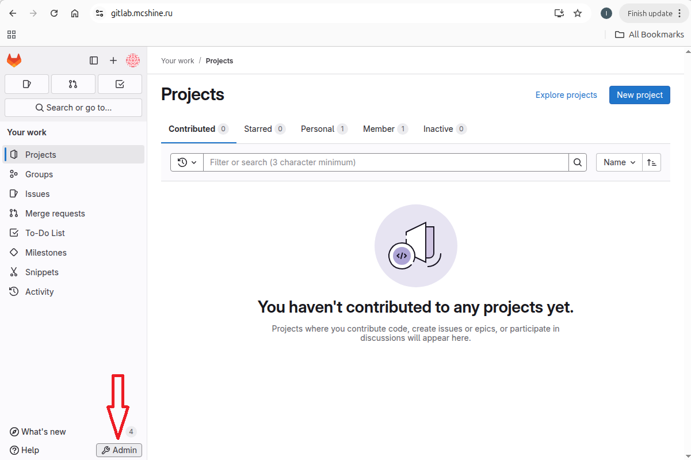

Далее, как и в проектном раннере, выбираем CI/CD -> Runners, но тут у нас есть кнопка, которая так и называется, создать инстансовый раннер:

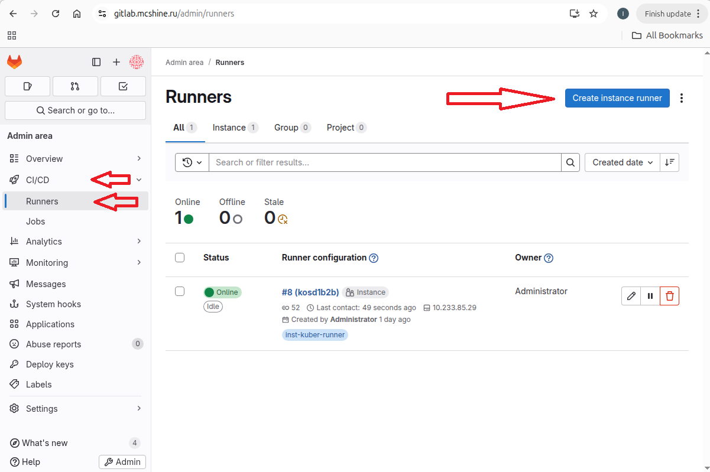

Далее, гитлаб создает раннер, и показывает нам токен для подключения. Его мы копируем. Еще тег пропишем и запретим обработку нетегированных задач.

Теперь осталось только подключиться. 

Поскольку нам надо раннер в кубернетесе, то лезем читать пару ссылок:

https://docs.gitlab.com/runner/executors/kubernetes/ - енто в принципе про возможности и настройки кубер реннера.

https://docs.gitlab.com/runner/install/kubernetes/ - енто про установку с помощью helm.

Использовать второй вариант не возбраняется.

Посмотрим, что нужно добавить в values.yaml.
```
gitlabUrl: Указываем адрес нашего гитлаба.
runnerToken: И токен в открытом виде. В секрет он его переведет сам.
```

По идее всё, но лучше сделать еще нексолько настроек. И первая - RBAC, для разграничения прав и доступа:
```
rbac:
  create: true
  rules:
    //Тут описываем, на что мы дадим права учетной записи раннера.
    - apiGroups: [""]
      resources: ["pods"]
      verbs: ["list", "get", "watch", "create", "delete"]
    - apiGroups: [""]
      resources: ["pods/exec"]
      verbs: ["create"]
    - apiGroups: [""]
      resources: ["pods/log"]
      verbs: ["get"]
    - apiGroups: [""]
      resources: ["pods/attach"]
      verbs: ["list", "get", "create", "delete", "update"]
```

Я выдал пачку прав на действия в подам, так как раннер должен будет только собирать образы и пушить на докерхаб (харбор в моем случае).\
Никаких правов на сервисы и неймспейсы ему не надыть давать. Разворачивать мы будет другой образой.

Что еще можно добавить?\
Сам файл config.toml хельмом собирается на этапе поднятия пода раннера из конфигов и файле values.yaml на енто можно повлиять:
```
  //Часть имеющаяся по умолчанию:
  config: |
    [[runners]]
      [runners.kubernetes]
        namespace = "{{ default .Release.Namespace .Values.runners.jobNamespace }}"
        //Допишем ниже несколько строк
        //Образ по умолчанию
        image = "docker.io/docker:latest"
        //Иногда может возникнуть проблема с дополнительным контейнером, который раннер добавляет в наш под,
        //что-бы тот отслеживал статус и выполнение нашего основного контейнера.
        //Проблема заключается в том, как раннер собирает имя образа хелпера. А потом вопит, 
        //что не может его найти и скачать.
        //Поентому выберем образ посвежее и укажем туть.
        helper_image = "registry.gitlab.com/gitlab-org/gitlab-runner/gitlab-runner-helper:alpine3.19-x86_64-v18.6.1-pwsh"
        //Поскольку мы докер в контейнере, то может возникнуть проблема с работой самого ентого докера,
        //так как он не сможет поднять сокет.
        //Поможем ему с ентим, и пробросим сокет с сервера.
        [[runners.kubernetes.volumes.host_path]]
          host_path = '/var/run/docker.sock'
          mount_path = '/var/run/docker.sock'
          name = 'docker-sock'
          read_only = true
```

Устанавливаем, проверяем коннект и начнем писать мега простой пайплайн для теста работы.

```
variables:
  //Зададим параметры нашему будущему образу
  CI_IMAGE_NAME: "test-booking-service"
  CI_IMAGE_TAG: "0.0.1"
  //Путь, относительно контекста, откуда копировать исходники сервиса
  CI_SERVICE_PATH: "./src/services/booking-service"
  //Нам надо залогиниться на наш докер хаб
  CI_REGISTRY: "docker.mcshine.ru/library"
  CI_REGISTRY_PASSWORD: "docker-password"
  CI_REGISTRY_USER: "docker-user"

default:
  tags:
    //Теги для раннера
    - inst-kuber-runner

stages:
  - build

build-job:
  stage: build
  image: docker.io/docker:latest
  //Прежде всего, надо залогиниться. Если не пройдет, то и собирать образ не имеет смысла.
  before_script:
    - echo $CI_REGISTRY_PASSWORD | docker login -u $CI_REGISTRY_USER $CI_REGISTRY --password-stdin
  script:
    - cd /builds/Elijah/do13-full
    //Собираем образ сразу с двумя тегами
    - docker build --build-context project=./ -t ${CI_REGISTRY}/${CI_IMAGE_NAME}:${CI_IMAGE_TAG} -t ${CI_REGISTRY}/${CI_IMAGE_NAME}:latest --build-arg SERVICE_PATH=${CI_SERVICE_PATH} ./build/service-docker
    //Закидываем на гитхаб
    - docker push ${CI_REGISTRY}/${CI_IMAGE_NAME}:${CI_IMAGE_TAG}
    - docker push ${CI_REGISTRY}/${CI_IMAGE_NAME}:latest
    - echo "Compile complete."
```

Теперь немного поговорим об удобстве и фичах гитлаба.\
Если мы залезем в Settings -> Integrations, то мы увидим, что гитлаб можно много к чему подключить. Я подключил Харбор.

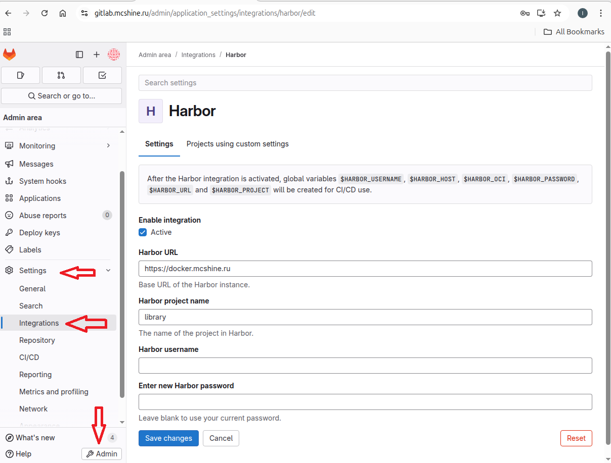

И теперь переменные CI_REGISTRY, CI_REGISTRY_PASSWORD и CI_REGISTRY_USER нам не нужны. У нас, заместо них, есть $HARBOR_USERNAME, $HARBOR_HOST, $HARBOR_OCI, $HARBOR_PASSWORD, $HARBOR_URL и $HARBOR_PROJECT.

Немного перепишем наш пайплайн:
```
variables:
  CI_IMAGE_NAME: "test-booking-service"
  CI_IMAGE_TAG: "0.0.1"
  CI_SERVICE_PATH: "./src/services/booking-service"

default:
  tags:
    - inst-kuber-runner

stages:
  - build

build-job:
  stage: build
  image: docker.io/docker:latest
  before_script:
    - echo $HARBOR_PASSWORD | docker login -u $HARBOR_USERNAME $HARBOR_HOST --password-stdin
  script:
    - cd /builds/Elijah/do13-full
    - docker build --build-context project=./ -t ${HARBOR_HOST}/${HARBOR_PROJECT}/${CI_IMAGE_NAME}:${CI_IMAGE_TAG} -t ${HARBOR_HOST}/${HARBOR_PROJECT}/${CI_IMAGE_NAME}:latest --build-arg SERVICE_PATH=${CI_SERVICE_PATH} ./build/service-docker
    - docker push ${HARBOR_HOST}/${HARBOR_PROJECT}/${CI_IMAGE_NAME}:${CI_IMAGE_TAG}
    - docker push ${HARBOR_HOST}/${HARBOR_PROJECT}/${CI_IMAGE_NAME}:latest
    - echo "Compile complete."
```

Запустим. Ждем. Видим единственную джобу. Завершилась успешно.

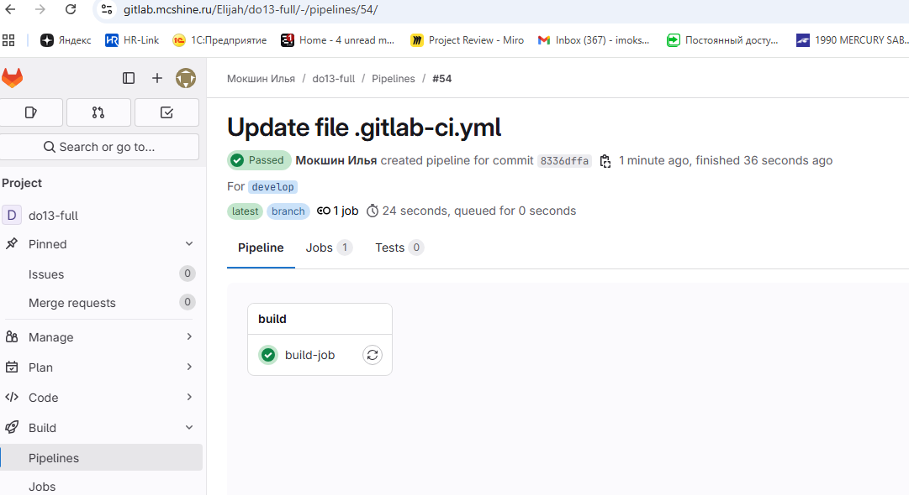

Судя отчету, проблем не возникло.


### Развертывание

Вот у нас есть образ/образы, как нам енто развернуть?

Чего может быть проще? Идем на кластер, вбиваем хельм инстралл и алга.

Но нам же надо автоматизацию. Вот и давайте пораскинем мозгами (только не так, как пассажир Джулса Уиннфилда и Винсента Веги в Криминальном чтиве) и подумаем, какие варианты у нас есть.
1. Можно сделать еще один раннер, но shell прямо на сервере/серверах кластера.

Вариант не дурной (на крайний случай). Мы получаем прямой доступ к командной строке одного из серверов кластера в полное управление. Особенно, если пользователю раннера дадим полные права. Но жЫрный минус - либо ставим на все ноды кластера, либо надеемся, что та, с которой разворачиваем, не упадет.

2. Использовать образ в которм есть kubectl.

Собрать его самим, если паранойя шалит, или использовать, к примеру, bitnami/kubectl:latest - дело ваше.\
Останется только вопрос, как логиниться к куберу с ентого kubectl.

Тут от гитлаба нам подгон - gitlab-agent для кубера.\
Официальная документация, тык туда - https://docs.gitlab.com/user/clusters/agent/ci_cd_workflow

Устанавливается он не сложно. В нашем проекте тыкаем Operate -> Kubernetes clusters -> Connect a cluster

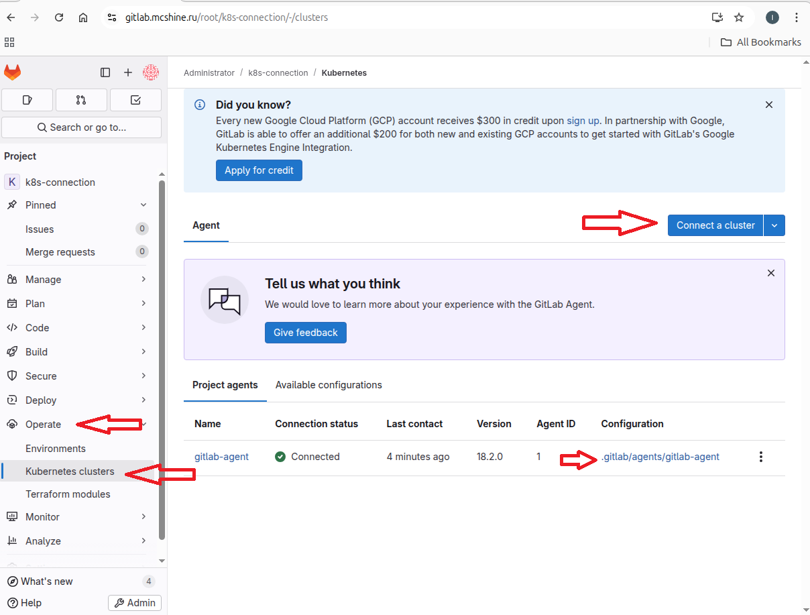

Далее вылезет окошко, где предложат выбрать имя нашему агенту, и выкатят инструкцию, как его установить.

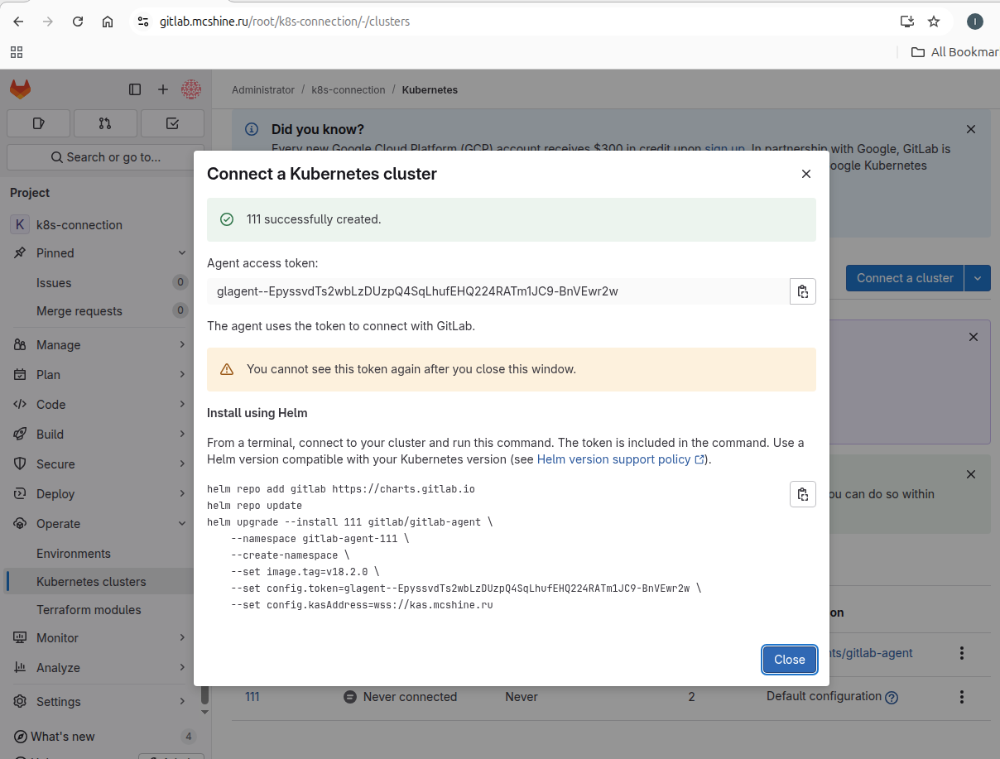

После установки надо будет создать папку для конфига агента (отмечено через скрин выше).\
Прелесть в том, что мы можем создать пустой проект только для агента, и в конфиге указывать те проекты, которым даем доступ на использование агента:
```
ci_access:
  projects:
    - id: Elijah/do13-full
```

Или, мы можем сделать агент инстансовым. Для ентого делаем следующее. В конфиге агента пишем так:
```
ci_access:
  instance: {}
```

Далее лезем в админку, Settings -> Generalь -> GitLab Agent for Kubernetes, ставим галочку, мол разрешить инстансовые агенты, и схороняем.


Теперь попробуем что-то сделать в самом проекте с присоединенным агентом. Превым делом узнаем контекст кубера:
```
default:
  tags:
    - inst-kuber-runner

stages:
  - build

deploy:
  image: docker.io/bitnami/kubectl:latest
  stage: build
  script:
    - kubectl config get-contexts
```

И вот мы видим, что нам надо использовать root/k8s-connection:gitlab-agent


Теперь в другом, микросервисовом проекте, попробуем воспользоваться данным агентом:
```
default:
  tags:
    - inst-kuber-runner

stages:
  - deploy

deploy:
  image: docker.io/bitnami/kubectl:latest
  variables:
    KUBE_CONTEXT: root/k8s-connection:gitlab-agent
  stage: deploy
  script:
    - kubectl config use-context "$KUBE_CONTEXT"
    - kubectl get pods -n do12-part2
```

И, да. Оно работает. У нас есть доступ к кластеру из контейнера, который находится в поде на ентом же кластере.


Вот мы и выполнили задачи с первой по шестую включительно.

## Часть вторая. Пайплайн

### Сборка

И вот с такой вводной базой мы уже можем подходить к выполнению задачи.

Первое, что перед нами встает - вопрос о том, как нам разбить задачу на шаги и заставить собирать и обновлять только те приложения, что были изменены. Мы не теперь не с монолитом работаем. В сущности, мы от него потому и ушли, что пересобирать всё целиком, если мы что-то поменяли в контроллере гейтвея будет слишком долго.

Сделаем вот что - заведём шаблон задания в пайплайне. И тогда первая часть, которая собирает наши приложения будет выглядеть так:
```
//Енто не задача в пайплайне, а только шаблон, расширение
.build-template:
  stage: build
  image: docker:latest
  //Вот тут, правилами и укажем, при каком событии и будет создаваться задача
  //Возьмем за правило создание задачи при изменении файлов в корне каталога, каталогов,
  //а также файлов и каталогов во вложенных каталогах каталога, который будет передан переменной SERVICE
  rules:
    - changes:
      - src/services/${SERVICE}/**/*
  variables:
    //Имя собираемого образа
    CI_IMAGE_NAME: "${HARBOR_HOST}/do13build/${SERVICE}"
  before_script:
    //Об ентом ниже
    - TS=${CI_COMMIT_TIMESTAMP}
    - CI_IMAGE_TAG="${TS:2:1}${TS:3:1}.${TS:5:1}${TS:6:1}.${TS:8:1}${TS:9:1}.${TS:11:1}${TS:12:1}.${TS:14:1}${TS:15:1}"
    //Логинимся на докерхабе
    //В сущности, тут уже знакомо
    - echo $HARBOR_PASSWORD | docker login -u $HARBOR_USERNAME $HARBOR_HOST --password-stdin
  script:
    - docker build -t ${CI_IMAGE_NAME}:${CI_IMAGE_TAG} -t ${CI_IMAGE_NAME}:latest --build-context project=./ --build-arg SERVICE_PATH=./src/services/$SERVICE ./build/service-docker
    - docker push ${CI_IMAGE_NAME}:${CI_IMAGE_TAG}
    - docker push ${CI_IMAGE_NAME}:latest

//А вот тут перечисляем возможные задачи

//Название задачи
booking-service:
  //Расширение шаблоном
  extends: .build-template
  variables:
    //И переменная. Если не будет изменено ничего из того каталога,
    //то задача не будет создана
    SERVICE: booking-service

gateway-service:
  extends: .build-template
  variables:
    SERVICE: gateway-service

hotel-service:
  extends: .build-template
  variables:
    SERVICE: hotel-service
```

Теперь остановимся вот на чем. Подумаем за имя образа и его способ хранения.

Если мы будем просто всё хранить в одном репозитории, то мы можем немного запутаться в имаджах и тогда где-то как-то накосячим.\
Поентому я предлагаю сделать так:
1. Образ собирается, и, в случае успешной сборки, заливается на тестовый репозиторий.
2. То, что образ собрался, не значит, что он работает как надо. Поентому следующим шагом мы его тестируем, и, если он прошел тесты, заливаем на репозиторий стейджа.
3. Если же и там всё ок, то можно его будет залить уже на прод.

Тут мы утыкаемся в следующую мысль, как их различать.

Вот тут вариантов много. Кто-то тегирует через SHA образа. Также общепринят формат версий. Типа "1.0.0".

Я же пойду другой путёй. Нам надо учесть, что образы сборки и теста будут меняться часто, поентому нормальное тегирование через "1.0.0" не совсем удобно. Да и надо отдельно инспектировать образ, чтобы узнать, к примеру, когда он был создан. Поентому, предлагаю вешать теги временной метки. Типа "25.11.30.14.47"

Но метка/тег должна быть едина на весь пайплайн. Для таких вещей у нас есть переменная CI_COMMIT_TIMESTAMP (https://docs.gitlab.com/ci/variables/predefined_variables/). Но с ней не все так ладно. Вот, к примеру, как себя ведет сделующий код на разных системах:
```
- date -d ${CI_COMMIT_TIMESTAMP} +%y.%m.%d.%H.%M
```

Ubuntu:

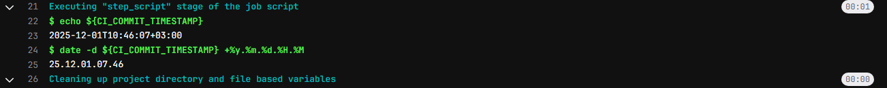

Alpine:

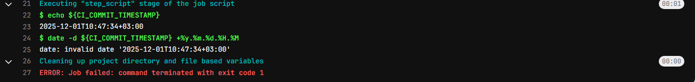

Поентому у нас есть несколько вариантов. Довольно простой - в начале пайплайна сделать стадию подготовки, чтобы на бубунте выполнилась конвертация времени и записалась в файл артефакта переменных окружения:
```
prepare-job:
  stage: prepare
  image: ubuntu:latest
  script:
    - echo "CI_IMAGE_TAG=$(date -d ${CI_COMMIT_TIMESTAMP} +%y.%m.%d.%H.%M)" >> variables.env
  artifacts:
    reports:
      dotenv: variables.env
```

Теперь в любой стадии, в любой задаче, которая использует ентот артефакт будет переменная окружения CI_IMAGE_TAG.

Другой вариант - в нужном месте делать некую операцию со строками. К примеру, через оффсет:
```
  //Укоротим название переменной
  - TS=${CI_COMMIT_TIMESTAMP}
  //Соберем из циферок на нужных местах
  - CI_IMAGE_TAG="${TS:2:1}${TS:3:1}.${TS:5:1}${TS:6:1}.${TS:8:1}${TS:9:1}.${TS:11:1}${TS:12:1}.${TS:14:1}${TS:15:1}"
```

И тогда, даже на Альпине будет такая картинка:

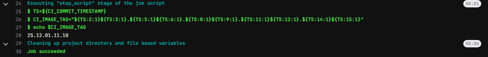

### Сборка тестов

Вот у нас есть образ, на котором 2 тега: метка времени и latest. А еще у нас есть с предыдущего задания Хельм чарты специально для ентих сервисов. Смекаете, к чему я?

Просто напишем спец файл с переменными, где укажем сервисы, качать образ с меткой latest (очень удобно), отключим персистант волюм для базы, и ингресс (я в 12м делал чарт гибким и универсальным).

Вот только, что надо учесть - у нас могет быть ситуевина, когда два или более погроммистов решат закоммитить свои решения примерно в одно время. Дабы у нас не произошло ошибки создания одного неймспейса два раза, то к имени неймспейса мы прибавим pipeline id.

И еще нюанс, надо передать секрет для докерхаба. Мы его соберем в строку и запихнем в файл Хельма прямо в задаче:
```
deploy-test:
  image: docker.io/dtzar/helm-kubectl
  variables:
    KUBE_CONTEXT: root/k8s-connection:gitlab-agent
  stage: test
  allow_failure: false
  before_script:
    //Вот такой образой получем строку логина и пароля в base64
    - AUTH_B64=$(echo -n "${HARBOR_USERNAME}:${HARBOR_PASSWORD}" | base64)
    - |
      cat > docker_cred <<EOF
      {
        "auths": {
          "${HARBOR_HOST}": {
            "auth": "${AUTH_B64}"
          }
        }
      EOF
    - echo -n "}" >> docker_cred
    //Вот тут переводим файл докер конфига в строку base64 и записываем последней строкой в файл со значениями Хельма
    - |
      printf '    value: %s' $(cat docker_cred | base64 -w 0) >> build/helm/values.yaml
  script:
    //Тут все просто. Разворачиваем Хельм релиз с учетом CI_PIPELINE_ID 
    //и дополнительного файла со значениями для тест среды values-test.yaml
    - kubectl config use-context "$KUBE_CONTEXT"
    - cd build/helm/
    - helm install do13-test-${CI_PIPELINE_ID} --namespace do13-test-${CI_PIPELINE_ID} --create-namespace -f values-test.yaml ./
```

### Тесты

Постмановские тесты:
```
postman-test:
  stage: test
  image: docker.io/postman/newman
  needs:
    - job: deploy-test
  //Надо подождать. Дадим сервисам нормально запуститься
  when: delayed
  start_in: 2 minutes
  script:
    //Запустим тесты с указанием переменных для хостов
    //Более того, репорт выведем и на экран, и в форрмате junit
    - newman run build/application_tests.postman_collection.json --env-var GATEWAY_HOST=do13-test-gateway-service-svc.do13-test-${CI_PIPELINE_ID}.svc --env-var USERS_HOST=do13-test-session-service-svc.do13-test-${CI_PIPELINE_ID}.svc --delay-request=1000 -r cli,junit --reporter-junit-export ./report.xml
  //Скачаем junit отчет
  artifacts:
    when: always
    paths:
      - report.xml
    reports:
      junit: report.xml
    expire_in: 10 days
```

Вот так будет выглядеть енто дело. Крайне удобно, даже в задачу проваливаться не надо:

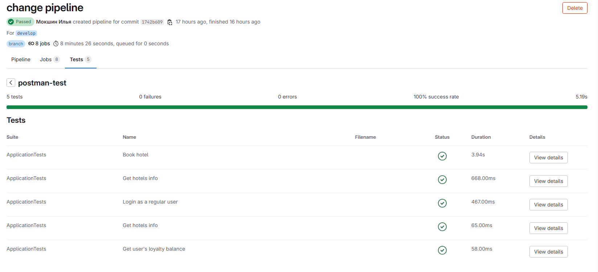

Но можно посмотреть и в задаче:

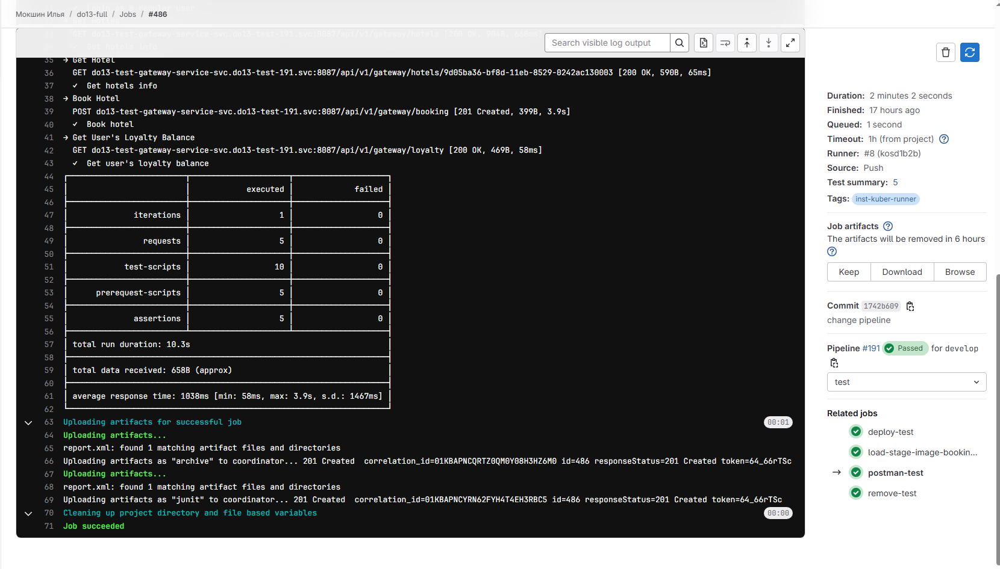

### После тестов

А вот тут начинается весёлое. Нам надо залить собранные ранее образы на репозиторий стейджа. И енто очень просто, так как если тесты не прошли, то задача и не запустится. Но еще нам надо удалить Хельвый релиз с неймспейсом. Причем, при любом исходе тестов. Более того, енти задачи, находясь в одной стадии с тестами надо запускать строго после выполения тестов.

Начнем с удаления:
```
remove-test:
  image: docker.io/dtzar/helm-kubectl
  allow_failure: true
  stage: test
  //Указываем, что надо запустить в любой случае
  when: always
  //Прямая зависимость. Будет ждать окончания, даже внутри одной стадии
  needs:
    - job: postman-test
  variables:
    KUBE_CONTEXT: root/k8s-connection:gitlab-agent
  script:
    //Туть и так понятно
    - kubectl config use-context "$KUBE_CONTEXT"
    - cd build/helm/
    - helm uninstall do13-test-${CI_PIPELINE_ID} --namespace do13-test-${CI_PIPELINE_ID}
    - kubectl delete namespace do13-test-${CI_PIPELINE_ID}
```

А залив образов будем делать тоже по шаблону, с теми же правилами, что и сборка, чтоб залить он пытался только те образы, что ранее собирались:
```
.load-stage-images-template:
  stage: test
  image: docker:latest
  allow_failure: false
  //Обозначаем, чтооно будет запускаться только при успешных тестах
  when: on_success
  //Зависимости
  needs:
    - job: postman-test
  //Правила
  rules:
    - changes:
      - src/services/$SERVICE/**/*
  variables:
    CI_IMAGE_NAME: "${HARBOR_HOST}/do13build/${SERVICE}"
    CI_STAGE_IMAGE_NAME: "${HARBOR_HOST}/do13stage/${SERVICE}"
  before_script:
    //Ентот конструкт мы уже видели
    - TS=${CI_COMMIT_TIMESTAMP}
    - CI_IMAGE_TAG="${TS:2:1}${TS:3:1}.${TS:5:1}${TS:6:1}.${TS:8:1}${TS:9:1}.${TS:11:1}${TS:12:1}.${TS:14:1}${TS:15:1}"
    - echo $HARBOR_PASSWORD | docker login -u $HARBOR_USERNAME $HARBOR_HOST --password-stdin
  script:
    //Теперь просто берем образ, меняем метки и заливаем в другое место
    - docker pull ${CI_IMAGE_NAME}:${CI_IMAGE_TAG}
    - docker tag ${CI_IMAGE_NAME}:${CI_IMAGE_TAG} ${CI_STAGE_IMAGE_NAME}:${CI_IMAGE_TAG}
    - docker push ${CI_STAGE_IMAGE_NAME}:${CI_IMAGE_TAG}
    - docker tag ${CI_STAGE_IMAGE_NAME}:${CI_IMAGE_TAG} ${CI_STAGE_IMAGE_NAME}:latest
    - docker push ${CI_STAGE_IMAGE_NAME}:latest

load-stage-image-booking-service:
  extends: .load-stage-images-template
  variables:
    SERVICE: booking-service

load-stage-image-gateway-service:
  extends: .load-stage-images-template
  variables:
    SERVICE: gateway-service
```

И вот теперь, у нас на репозитории стейджа только протестированные образы. Они, как минимум не падают при первом обращении к ним.

Но дабы окончательно в ентом убедиться, и не лить все на прод, поднимем некий стек, который будет доступен для других тестов и других тестировщиков.

### Деплой стейджа

Тут у нас есть несколько подходов:
1. Убиваем старый стейдж, поднимаем новый. Вариант не такой плохой, как может показаться, так как мы будем использовать персистант волюм для базы, так что наработки не пропадут.
2. Тупо апдейтим все сервисы на стейдже. В отличие от предыдущего варианта, недоступность сервера будет помемсче.
3. Апдейтим только те сервисы, которые пересобирали ранее.

Попробуваем третий вариант.

Еще надо учесть, что у нас стейжд может уже быть, а может еще не быть.

Ну и еще деталь при таком раскладе - сам деплой запускаем вручную, если стейджа не существует, то он собирает его, скачивая при ентом образы всех сервисов, а если он существует, то надо, автоматически запустить задачи на обновление ентих сервисов.

Будет оно выглядеть так:
```
deploy-stage:
  image: docker.io/dtzar/helm-kubectl
  variables:
    KUBE_CONTEXT: root/k8s-connection:gitlab-agent
  stage: deploy-stage
  //Запуск вручную
  when: manual
  allow_failure: false
  //Знакомый перевод пароля в секрет
  before_script:
    - AUTH_B64=$(echo -n "${HARBOR_USERNAME}:${HARBOR_PASSWORD}" | base64)
    - |
      cat > docker_cred <<EOF
      {
        "auths": {
          "${HARBOR_HOST}": {
            "auth": "${AUTH_B64}"
          }
        }
      EOF
    - echo -n "}" >> docker_cred
    - |
      printf '    value: %s' $(cat docker_cred | base64 -w 0) >> build/helm/values.yaml
  script:
    - kubectl config use-context "$KUBE_CONTEXT"
    - cd build/helm/
    //Вот тут сделаем вот что - создадим файл с переменной окружения CI_STAGE_CREATED,
    //которая будет давать понять следующим задачам, надо ли выполнять обновление сервиса
    - |
      //Условие проверки существования неймспейса
      if kubectl get namespaces | grep do13-stage
      then 
        //Если оно есть, то пусть себе спокойно обновляются сервисы
        echo "CI_STAGE_CREATED=false" >> variables.env
        echo "New stage deploy will not be deployed"
      else 
        //Если нет, то развернем с переменными стейджа в values-stage.yaml.
        //Установим персистант волюм базы и ингресс контроллер
        helm install do13-stage --namespace do13-stage --create-namespace -f values-stage.yaml ./ 
        echo "CI_STAGE_CREATED=true" >> variables.env
        echo "New stage deploy was deployed"
      fi
  artifacts:
    reports:
      dotenv: ./build/helm/variables.env
```

Далее снова шаблон для сервисов:
```
.update-deploy-image-template:
  stage: deploy-stage
  image: docker.io/bitnami/kubectl:latest
  allow_failure: false
  when: on_success
  needs:
    - job: deploy-stage
  rules:
    - changes:
      - src/services/$SERVICE/**/*
  variables:
    KUBE_CONTEXT: root/k8s-connection:gitlab-agent
  script:
    - |
      //Если на предыдущей задаче ничего не создали нового
      if [ "$CI_STAGE_CREATED" == "false" ]
      then 
        //То просто обновляем нужный деплоймент.
        //Оно скачает заново образ с меткой latest
        kubectl -n do13-stage rollout restart deploy do13-stage-${SERVICE}-app
        echo "${SERVICE} was updated"
      fi

update-deploy-image-booking-service:
  extends: .update-deploy-image-template
  variables:
    SERVICE: booking-service

update-deploy-image-gateway-service:
  extends: .update-deploy-image-template
  variables:
    SERVICE: gateway-service
```

### Сбор воедино и прогон с картинками

Тут довольно просто:
```
workflow:
  rules:
    //Если контекст коммита, но есть открытый MR, то НЕ запускаем
    - if: '$CI_COMMIT_BRANCH && $CI_OPEN_MERGE_REQUESTS'
      when: never
    //Если же коммит в ветку с префиксом feature_ и были реальные изменения сервисов, то запускаем
    - if: $CI_COMMIT_REF_NAME =~ /^feature_.*$/
      changes:
      - src/services/**/*
      when: always
    //В остальных случаях НЕ запускаем
    - when: never

default:
  tags:
    //Наш кубер
    - inst-kuber-runner

stages:
  - build
  - test
  - deploy-stage

//И перечисляем описанные выше файлы, чтоб не засорять основной пайплайн
include:
  - 'gitlab-ci/template-build.yml'
  - 'gitlab-ci/template-test.yml'
  - 'gitlab-ci/template-stage.yml'
```

Ну и все. Тперь начинаем картинки:

Вот так выглядит начало нашей сборки. Обратите внимание, что у нас только три этапа и куча задач сама создалась:

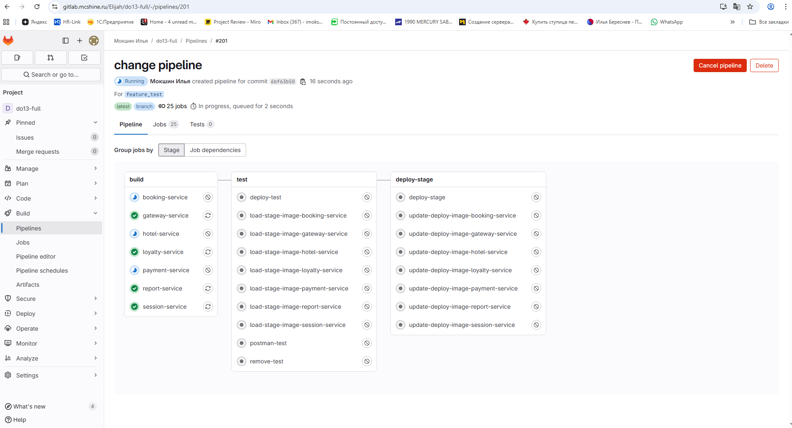

А вот выглядит оно же, но разделенное на связи и зависимости. Как видим, постмановские тесты пойдут только после развертки тестового деплоймента, а вот залив на докерхаб и удаление тестового деплоймента пойдут одновременно:

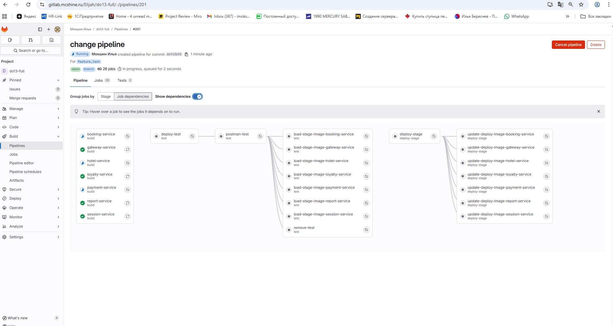

Оно собралось и поднялся тестовый деплоймент, но теперь оно выжидает время, на которое мы отложили выполнение тестов:

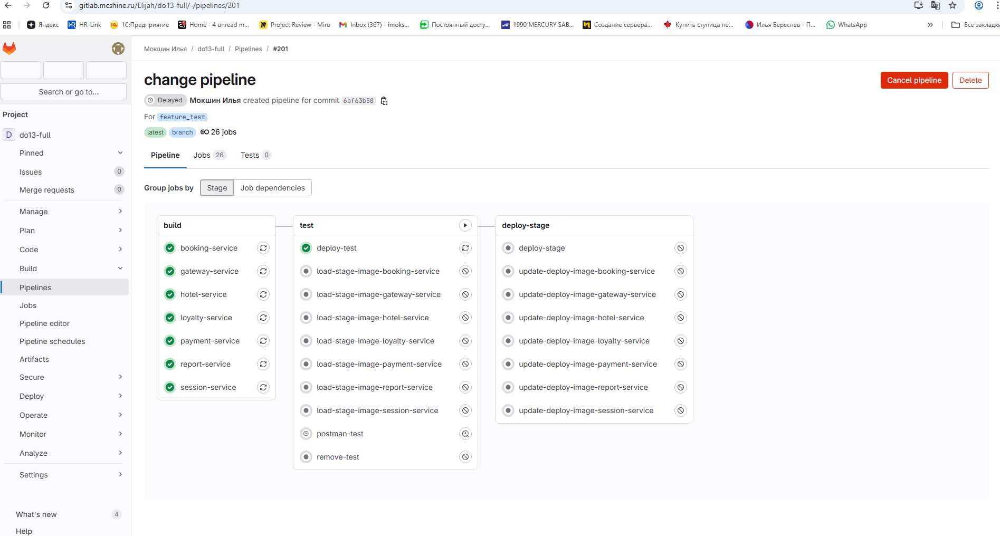

Отсчет можно увидеть и так:

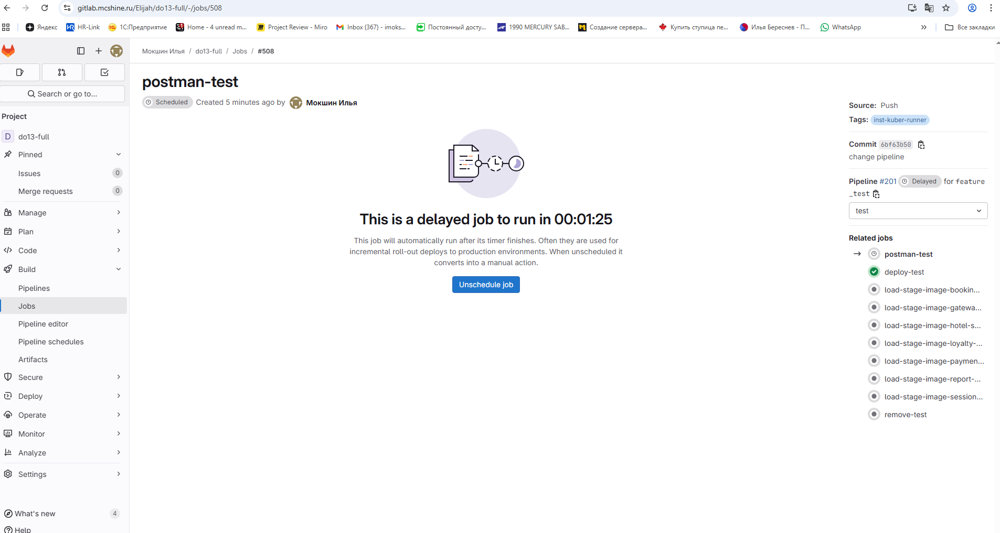

Теперь ожидает запуска развертки на стейдж:

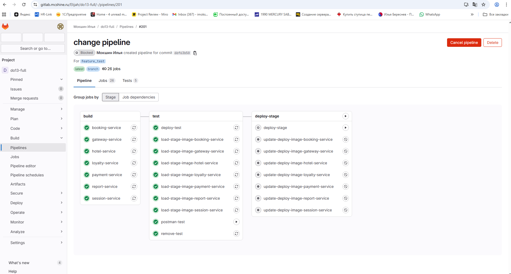

Идет процесс (запустили одно, а оно потянуло кучку задач):


Видим, что сценарий пошел по пути разверки нового деплоймента:

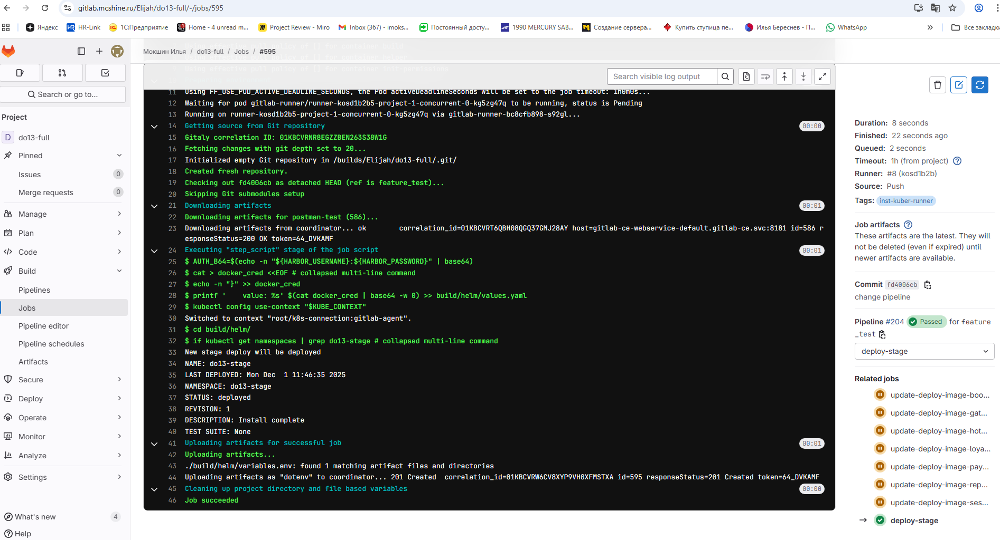

А значит, в задачах апдейта деплойментов сервисов мы ничего не увидим:

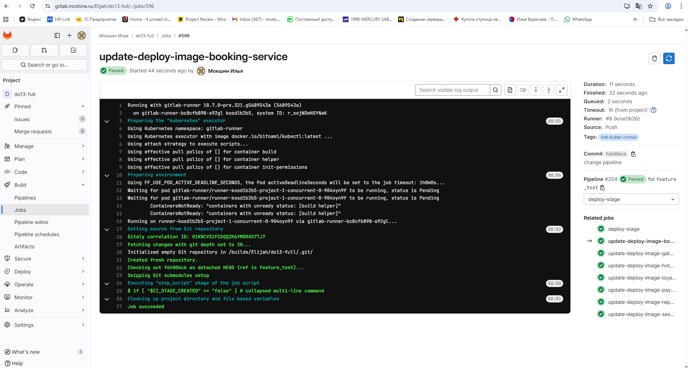

Теперь неплохо было бы проверить, как работает апдейт. Нас просят поменять зависимости. Но я считаю енто неинформативным.

У нас в букинг сервисе с 9го ДО остались самописные метрики. Вот давайте её копирнем, сделаем такую же, но с другим именем. Закоммитим, запушим, пусть билдит (что бы енти слова не значили). Видим, что Гитлаб среагировал, но теперь у нас задача только на один из микросервисов:

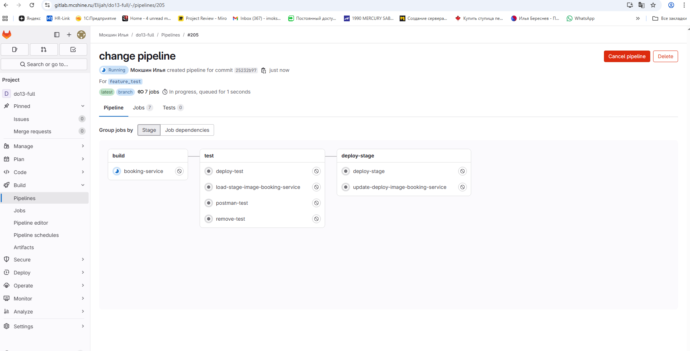

Деплой стейджа теперь показывает, что у нас есть развернутый стейдж, поентому сам он ничего не делает:

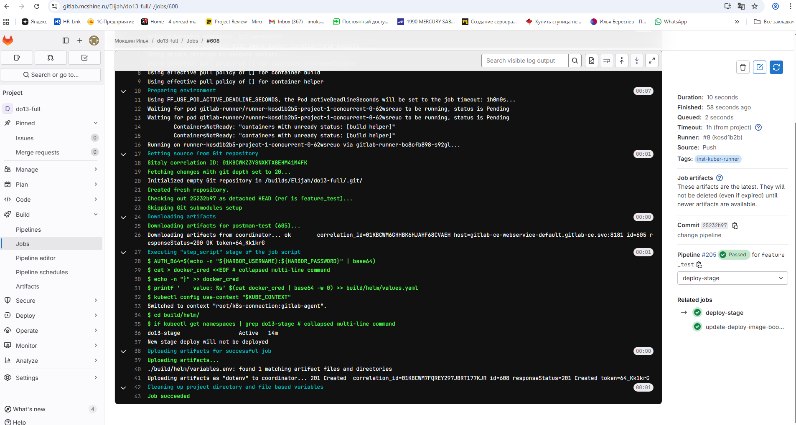

Зато делает вспомогательная задача:

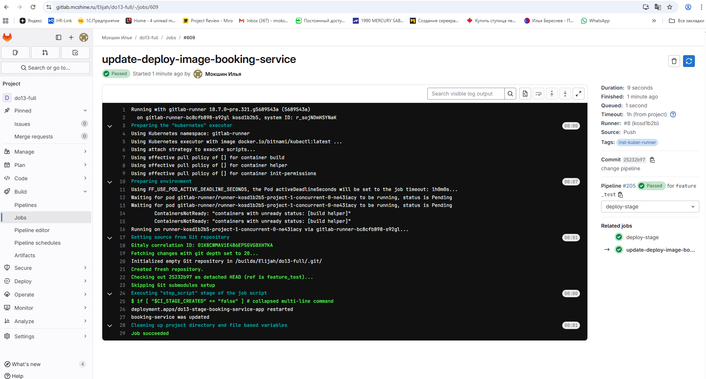

Ну и можно посмотреть пару запросов метрик. До, и после обновления:

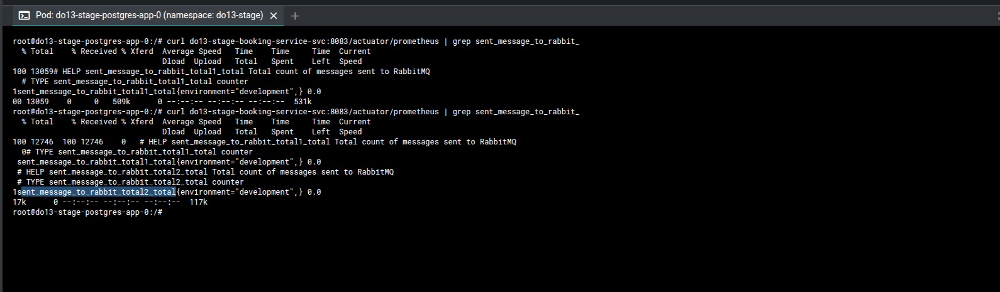

## Часть третья, дополнительная. Прод

Хоть от нас не требуют, но я хотел бы рассказать об еще одном интересном инструменте. Называется он ArgoCD.

Сразу, из названия, понятно, что он выполняет только часть деплоя. Но нам больше и не надо.

Мы можем сделать вот как: погроммисты пишут кот, потом наш пайплайн его собирает, тестирует и разгоняет на стейдж. А вот как оно будет дальше попадать на прод и где находится ентот прод погроммистов уже не должно волновать. Поентому мы наш пайплайн дополним возможностью для манагера запушить в докерхаб удачный образ, после того как пройдут тесты на стейдже. А разворачиваться прод будет отдельно, используя отсеянные для него образы.

Собственно говоря, стейдж тоже можно разворачивать через Арго, но, чтоб придерживаться рамок задания, оставим ему только прод.

Устанавливается Арго просто, через Хельм, в отдельный неймспейс. Сам Арго создает несколько новых сущностей, минимальная из них - Application:
```
apiVersion: argoproj.io/v1alpha1
kind: Application
metadata:
  name: do13-prod
  namespace: argocd
  finalizers:
    - resources-finalizer.argocd.argoproj.io     
spec:
  destination:
    name: in-cluster
    namespace: do13-prod
  project: default
  source:
    repoURL: "https://gitlab.mcshine.ru/root/argocd-root.git"
    path: "helmcharts/do13prodchart"
    targetRevision: HEAD
  syncPolicy:
    automated:
      prune: true
      selfHeal: true
    syncOptions:
      - CreateNamespace=true
```

Примерно так. Что мы тут сделали? Мы говорим Арго, чтоб он смотрел по некоему гитлабовкому (гитхабовскому) адресу, и искал там Хельм чарты. Причем искал в текущей ветви. И, если нашел, разворачивать его в том же кластере, где и Арго, но в указанном неймспейсе.

В теории, ентого достаточно. Если мы сделаем кубситиэл апплай, то оно начнет работать. Но можно сделать еще прикольнее, и сделать корневой аппликейшн, который будет разворачивать не наши сервисы, а другие приложения:
```
apiVersion: argoproj.io/v1alpha1
kind: Application
metadata:
  name     : root
  namespace: argocd
  finalizers:
  - resources-finalizer.argocd.argoproj.io
spec:
  destination:
    name     : in-cluster
    namespace: argocd
  source:
    path   : "applications"
    repoURL: "https://gitlab.mcshine.ru/root/argocd-root.git"
    targetRevision: HEAD
  project: default
  syncPolicy:
    automated:
      prune   : true
      selfHeal: true
```

У меня есть проект в гитлабе, в корне лежит рутовый аппликейшн, на всякий случай. В папке applications менефесты, других приложений. И мне не надо делать каждый раз кубситиэл апплай, за меня приложение развернет корневой аппликейшн. А уже развёрнутые аппликейшены будут разворачивать сверисы из папки с Хельм чартами.

Теперь дополним наш пайплайн:
```
.load-prod-images-template:
  stage: approve-to-prod
  image: docker:latest
  allow_failure: false
  when: manual
  needs:
    - job: postman-test
  rules:
    - changes:
      - src/services/$SERVICE/**/*
  variables:
    CI_IMAGE_NAME: "${HARBOR_HOST}/do13stage/${SERVICE}"
    CI_STAGE_IMAGE_NAME: "${HARBOR_HOST}/do13prod/${SERVICE}"
  before_script:
    - TS=${CI_COMMIT_TIMESTAMP}
    - CI_IMAGE_TAG="${TS:2:1}${TS:3:1}.${TS:5:1}${TS:6:1}.${TS:8:1}${TS:9:1}.${TS:11:1}${TS:12:1}.${TS:14:1}${TS:15:1}"
    - echo $HARBOR_PASSWORD | docker login -u $HARBOR_USERNAME $HARBOR_HOST --password-stdin
  script:
    - docker pull ${CI_IMAGE_NAME}:${CI_IMAGE_TAG}
    - docker tag ${CI_IMAGE_NAME}:${CI_IMAGE_TAG} ${CI_STAGE_IMAGE_NAME}:${CI_IMAGE_TAG}
    - docker push ${CI_STAGE_IMAGE_NAME}:${CI_IMAGE_TAG}
    - docker tag ${CI_STAGE_IMAGE_NAME}:${CI_IMAGE_TAG} ${CI_STAGE_IMAGE_NAME}:latest
    - docker push ${CI_STAGE_IMAGE_NAME}:latest

load-prod-image-booking-service:
  extends: .load-prod-images-template
  variables:
    SERVICE: booking-service

load-prod-image-gateway-service:
  extends: .load-prod-images-template
  variables:
    SERVICE: gateway-service
```

И прогоним енто в гитлабе:

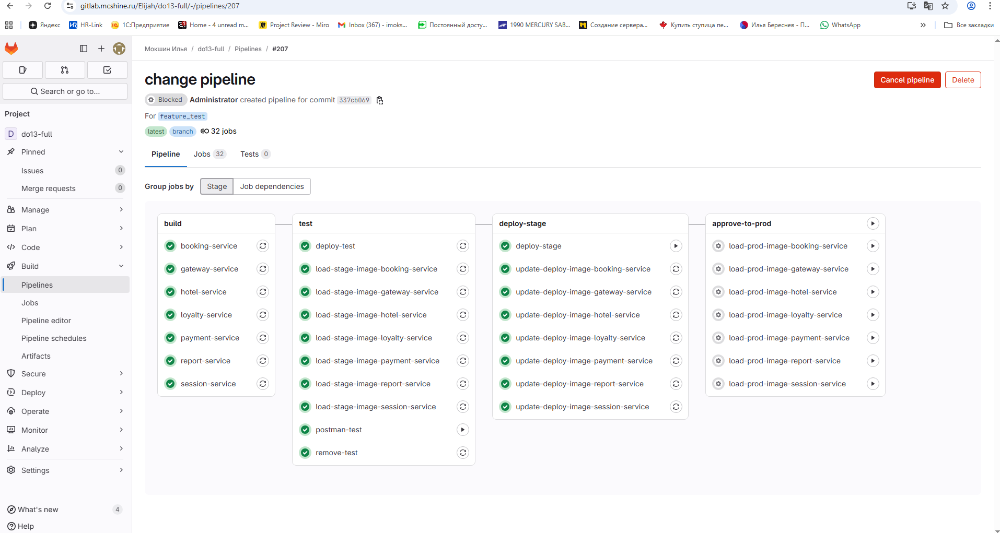

И перейдем в АргоСД, посмотрим, как развернулось наше приложение:

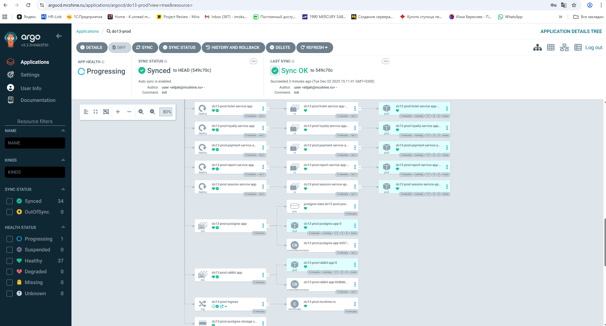

Можно посмотреть, как поды рассосались по нодам:

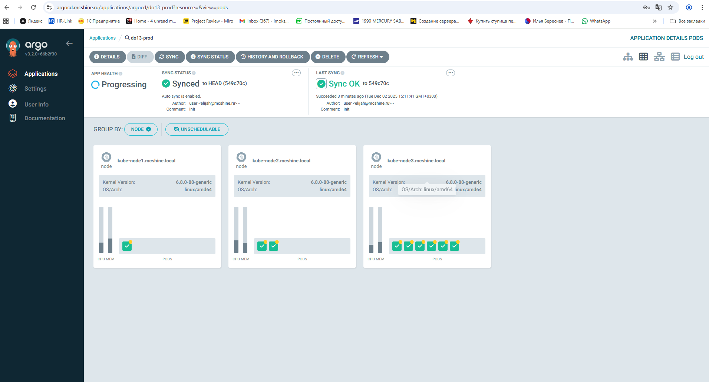

А также, поглядеть на сетевые взаимосвязи:

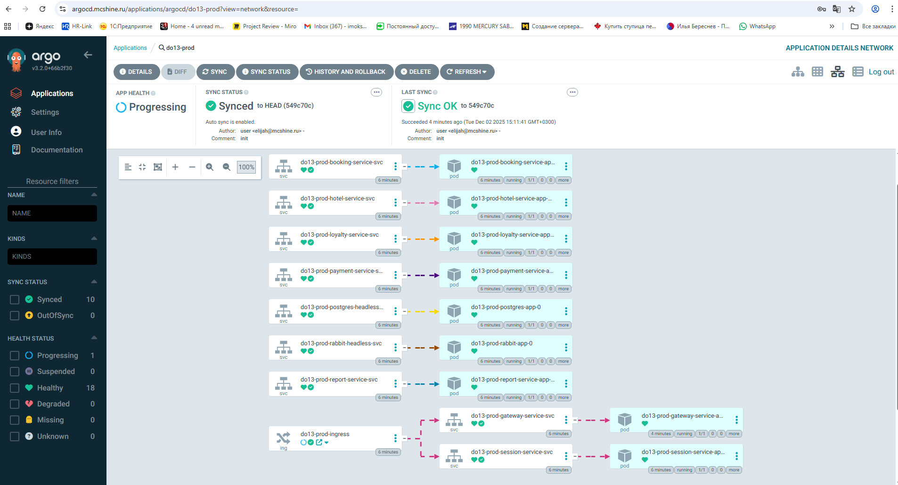

Вот оно у нас развернуто, и всё красиво. Но, вы можете спросить, зачем оно нам, если так мы могли сделать и через гитлаб, а обновления делать через кубер?

Ответ - к АргоСД есть плагин, который наблюдает за образами на докерхабе, и если там появилось что-то новое (или отвечающее иным требованиям), то он сам делает апдейт сервиса.

Читайте сюда: https://argocd-image-updater.readthedocs.io/en/latest/

Устанавливаем, можно в отдельный неймспейс, можно к АргоСД. И настраиваем.

Раньше, автоапдейтер был самостоятельным подом, и наш аппликейшен бы выглядел примерно так:
```
apiVersion: argoproj.io/v1alpha1
kind: Application
metadata:
  name     : root
  namespace: argocd
  finalizers:
  - resources-finalizer.argocd.argoproj.io
  annotations:
    argocd-image-updater.argoproj.io/image-list: loyaltyimage=docker.mcshine.ru/do13prod/loyalty-service, sessionimage=docker.mcshine.ru/do13prod/session-service, gatewayimage=docker.mcshine.ru/do13prod/gateway-service, paymentimage=docker.mcshine.ru/do13prod/payment-service, hotelimage=docker.mcshine.ru/do13prod/hotel-service, bookingimage=docker.mcshine.ru/do13prod/booking-service, reportimage=docker.mcshine.ru/do13prod/report-service
    argocd-image-updater.argoproj.io/bookingimage.helm.image-name: bookingservice.image.name
    argocd-image-updater.argoproj.io/bookingimage.helm.image-tag: bookingservice.image.tag
    argocd-image-updater.argoproj.io/bookingimage.update-strategy: alphabetical
    argocd-image-updater.argoproj.io/bookingimage.ignore-tags: latest

    argocd-image-updater.argoproj.io/gatewayimage.helm.image-name: gatewayservice.image.name
    argocd-image-updater.argoproj.io/gatewayimage.helm.image-tag: gatewayservice.image.tag
    argocd-image-updater.argoproj.io/gatewayimage.update-strategy: alphabetical
    argocd-image-updater.argoproj.io/gatewayimage.ignore-tags: latest

    argocd-image-updater.argoproj.io/hotelimage.helm.image-name: hotelservice.image.name
    argocd-image-updater.argoproj.io/hotelimage.helm.image-tag: hotelservice.image.tag
    argocd-image-updater.argoproj.io/hotelimage.update-strategy: alphabetical
    argocd-image-updater.argoproj.io/hotelimage.ignore-tags: latest

    argocd-image-updater.argoproj.io/loyaltyimage.helm.image-name: loyaltyservice.image.name
    argocd-image-updater.argoproj.io/loyaltyimage.helm.image-tag: loyaltyservice.image.tag
    argocd-image-updater.argoproj.io/loyaltyimage.update-strategy: alphabetical
    argocd-image-updater.argoproj.io/loyaltyimage.ignore-tags: latest

    argocd-image-updater.argoproj.io/paymentimage.helm.image-name: paymentservice.image.name
    argocd-image-updater.argoproj.io/paymentimage.helm.image-tag: paymentservice.image.tag
    argocd-image-updater.argoproj.io/paymentimage.update-strategy: alphabetical
    argocd-image-updater.argoproj.io/paymentimage.ignore-tags: latest

    argocd-image-updater.argoproj.io/reportimage.helm.image-name: reportservice.image.name
    argocd-image-updater.argoproj.io/reportimage.helm.image-tag: reportservice.image.tag
    argocd-image-updater.argoproj.io/reportimage.update-strategy: alphabetical
    argocd-image-updater.argoproj.io/reportimage.ignore-tags: latest

    argocd-image-updater.argoproj.io/sessionimage.helm.image-name: sessionservice.image.name
    argocd-image-updater.argoproj.io/sessionimage.helm.image-tag: sessionservice.image.tag
    argocd-image-updater.argoproj.io/sessionimage.update-strategy: alphabetical
    argocd-image-updater.argoproj.io/sessionimage.ignore-tags: latest
spec:
  destination:
    name     : in-cluster
    namespace: argocd
  source:
    path   : "applications"
    repoURL: "https://gitlab.mcshine.ru/root/argocd-root.git"
    targetRevision: HEAD
  project: default
  syncPolicy:
    automated:
      prune   : true
      selfHeal: true
```

Т.е. всё, что надо, мы бы задали в аннотациях и он бы сам создал сущность апдейтера. Но в текущей версии оно крутит апдейт контроллер, а сами апдейтеры можно написать самому:
```
apiVersion: argocd-image-updater.argoproj.io/v1alpha1
kind: ImageUpdater
metadata:
  name: image-updater
spec:
  namespace: argocd
  commonUpdateSettings:
    updateStrategy: "alphabetical"
    forceUpdate: true
    ignoreTags: 
      - latest
  applicationRefs:
    - namePattern: do13-prod
      images:
        - alias: "bookingimage"
          imageName: "docker.mcshine.ru/do13prod/booking-service"
          manifestTargets:
            helm:
              name: bookingservice.image.name
              tag: bookingservice.image.tag
        - alias: "gatewayimage"
          imageName: "docker.mcshine.ru/do13prod/gateway-service"
          manifestTargets:
            helm:
              name: gatewayservice.image.name
              tag: gatewayservice.image.tag
        - alias: "hotelimage"
          imageName: "docker.mcshine.ru/do13prod/hotel-service"
          manifestTargets:
            helm:
              name: hotelservice.image.name
              tag: hotelservice.image.tag
        - alias: "loyaltyimage"
          imageName: "docker.mcshine.ru/do13prod/loyalty-service"
          manifestTargets:
            helm:
              name: loyaltyservice.image.name
              tag: loyaltyservice.image.tag
        - alias: "paymentimage"
          imageName: "docker.mcshine.ru/do13prod/payment-service"
          manifestTargets:
            helm:
              name: paymentservice.image.name
              tag: paymentservice.image.tag
        - alias: "reportimage"
          imageName: "docker.mcshine.ru/do13prod/report-service"
          manifestTargets:
            helm:
              name: reportservice.image.name
              tag: reportservice.image.tag
        - alias: "sessionimage"
          imageName: "docker.mcshine.ru/do13prod/session-service"
          manifestTargets:
            helm:
              name: sessionservice.image.name
              tag: sessionservice.image.tag
```

Применим манифест и попробуем что-то поменять в нашем букинг сервисе:

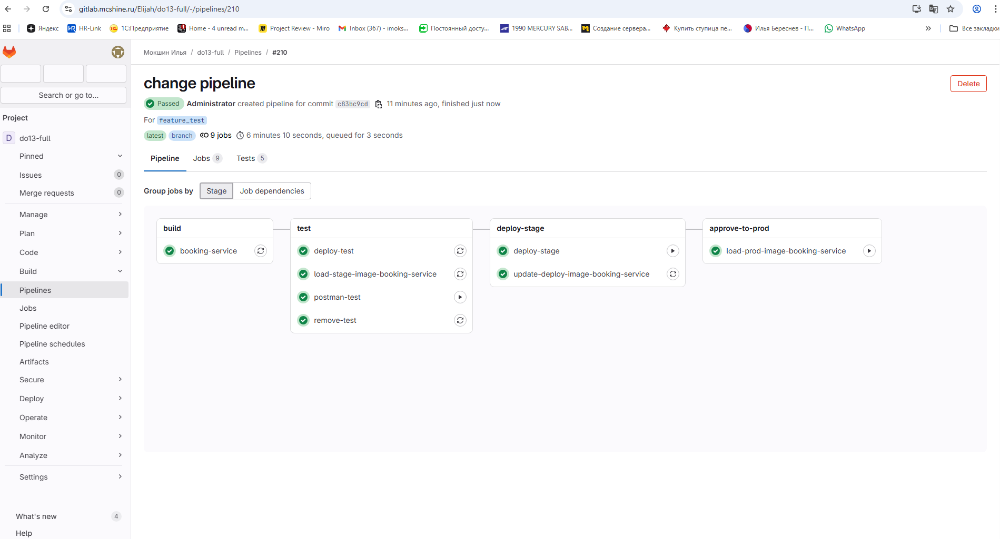

А потом просто наблюдаем, как автоапдейтер в АргоСД сам развернул новую ревизию нашего сервиса:

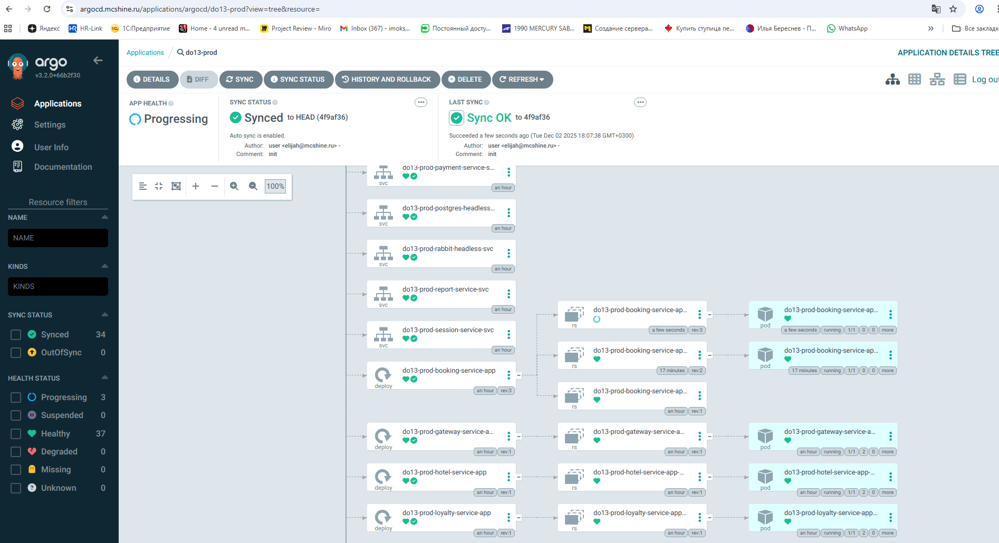

## Часть четвертая, печальная. Школьный гитлаб

После того, как мы узнали о довольно приятных и удобных инструментах, перенесемся в школьные реалии.

Что нас ожидает: один токен на раннер, отсутствие кубер агента, интеграции в Харбор и невозможность использовать проектные переменные.

Как будем выходить из ситуёвины:
1. Запускать пайплайн руками
2. При запуске указывать пачку переменных
3. Kubectl подключать по конфигу
4. Конфиг будем передавать в base64

### Проба

Начнем с того, что попробуем подключиться к куберу по конфигу. Сделаем пайплайн с единственной задачей:
```
deploy:
  when: manual
  image: docker.io/bitnami/kubectl:latest
  stage: build
  script:
    - echo ${DEPLOY_CREDENTIALS} | base64 -d >> config
    - export KUBECONFIG=config
    - kubectl config get-contexts
    - kubectl config use-context kubernetes-admin@cluster.local
    - kubectl get pods -n do12-part2
```

Запустим, передав конфиг для подключения:

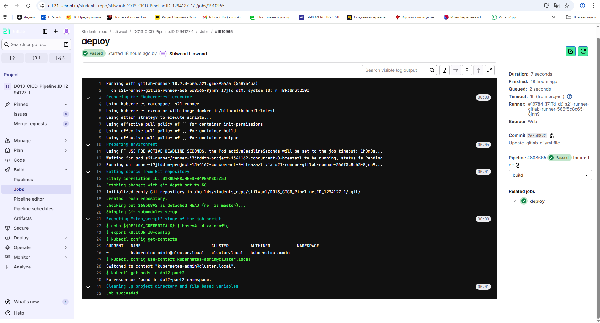

Видно, что он успешно подключился, и даже попытался посмотреть поды несуществующем неймспейсе.

Теперь переделаем наш пайплайн:
```
workflow:
  rules:
    - if: '$CI_COMMIT_BRANCH && $CI_OPEN_MERGE_REQUESTS'
      when: never
    - if: $CI_COMMIT_REF_NAME =~ /^feature_.*$/
      changes:
      - src/services/**/*
      when: always
    - when: never

//Вот сюда переехало определение пачки переменных
variables:
  DEPLOY_CREDENTIALS:
  description: "The deployment credentials"
  KUBE_CONTEXT:
  description: "Kuberenetes context"
  HARBOR_HOST:
  description: "Docker hub host"
  HARBOR_USERNAME:
  description: "Docker hub user"
  HARBOR_PASSWORD:
  description: "Docker hub password"

stages:
  - build
  - test
  - deploy-stage

include:
  - 'gitlab-ci/template-build.yml'
  - 'gitlab-ci/template-test.yml'
  - 'gitlab-ci/template-stage.yml'
```

А в задачах, которые развертывают тесты и стейджи, добавилось следующее:
```
  script:
    - echo ${DEPLOY_CREDENTIALS} | base64 -d >> config
    - export KUBECONFIG=config
    - kubectl config use-context "$KUBE_CONTEXT"
```

Теперь запустим все енто, создав ветку feature_test:

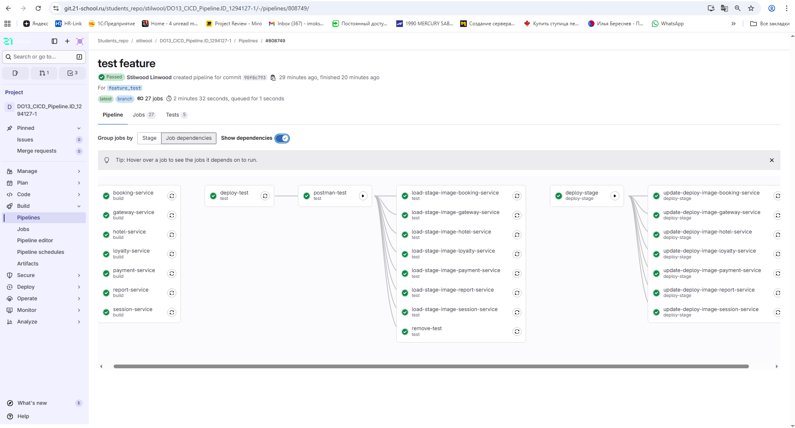

Видно, что всё прошло замечательно. Но есть и неудоство - ручной запуск.\
А вот, что будет, если оно попытается автоматически стартануть:

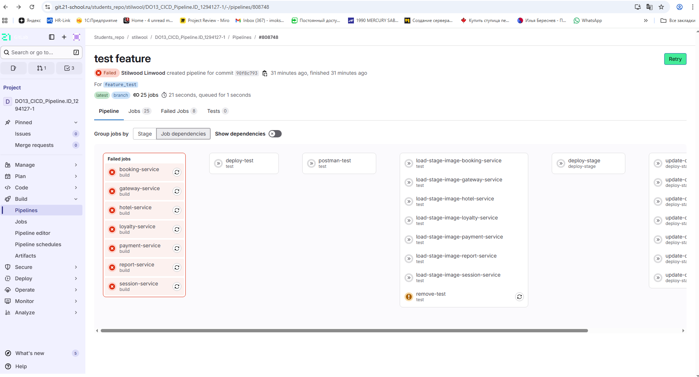

Ошибку, думаю, угадать несложно:

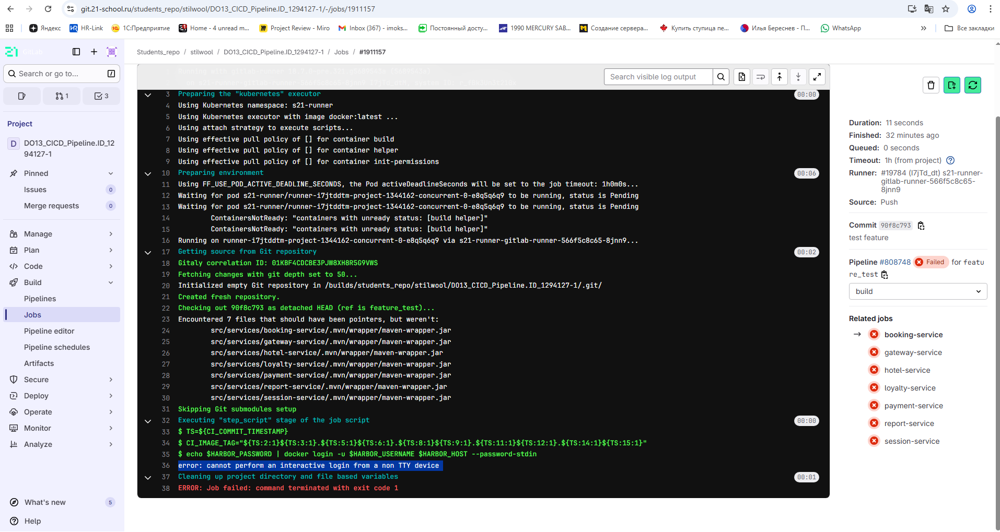

## Опосля написанного

В данном задании мы с вами попробовали сделать одно и то же разными путями. Где-то енто проще, где-то сложнее и неудобнее.

Что еще можно было привинтить? Можно разнести все микросервисы по разным проектам, чтоб у погроммистов разных команд не было соблазна подпортить жЫзнь коллегам. Еще, в такой разе, было бы неплохо подключить команду тестировщиков, чтоб написали тесты для отделных сервисов. Превентивные тесты, чтоб не собирать тестовый деплой раньше времени.

Сам тестовый деплой тоже вынести отдельно и выдать его только компетентным специалистам. Можно, как уже писал выше, его тоже передать АргоСД. А кнопку залива продовых образов сделать доступной только тем, кто несет ответственность за продукт.